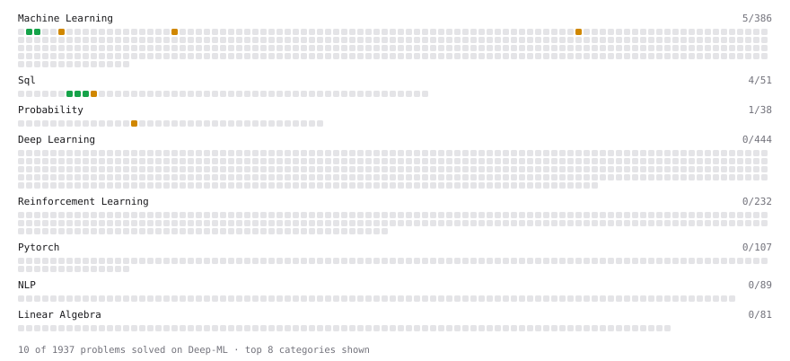

# Deep-ML

My machine learning practice from [Deep-ML](https://www.deep-ml.com). Every solution here was written by hand.

**10** solved · 10 problems · 0 labs · 0 math

[**Browse the interactive portfolio**](https://christianfaccio.github.io/deep-ml/) to replay this filling in over time.

## Problems

| | Difficulty | Solved | |
| --- | --- | --- | --- |
| [Average per group](https://www.deep-ml.com/problems/1108) | easy | 2026-11-06 | [solution](problems/1108-average-per-group) |
| [Count rows per group](https://www.deep-ml.com/problems/1107) | easy | 2026-11-06 | [solution](problems/1107-count-rows-per-group) |
| [Feature Scaling Implementation](https://www.deep-ml.com/problems/16) | easy | 2026-10-27 | [solution](problems/0016-feature-scaling-implementation) |
| [Linear Regression Using Gradient Descent](https://www.deep-ml.com/problems/15) | easy | 2026-10-27 | [solution](problems/0015-linear-regression-using-gradient-descent) |
| [Your first JOIN](https://www.deep-ml.com/problems/1109) | easy | 2026-11-06 | [solution](problems/1109-your-first-join) |
| [Birthday Problem Probability](https://www.deep-ml.com/problems/246) | medium | 2026-11-06 | [solution](problems/0246-birthday-problem-probability) |
| [Implement Gradient Descent Variants with MSE Loss](https://www.deep-ml.com/problems/47) | medium | 2026-10-29 | [solution](problems/0047-implement-gradient-descent-variants-with-mse-loss) |
| [Implement Precision-Recall Curve](https://www.deep-ml.com/problems/278) | medium | 2026-10-29 | [solution](problems/0278-implement-precision-recall-curve) |
| [Nth-Highest Salary with Ties and NULL](https://www.deep-ml.com/problems/1110) | medium | 2026-11-06 | [solution](problems/1110-nth-highest-salary-with-ties-and-null) |
| [Principal Component Analysis (PCA) Implementation](https://www.deep-ml.com/problems/19) | medium | 2026-10-28 | [solution](problems/0019-principal-component-analysis-pca-implementation) |

---

_This file is regenerated by Deep-ML on every push._
